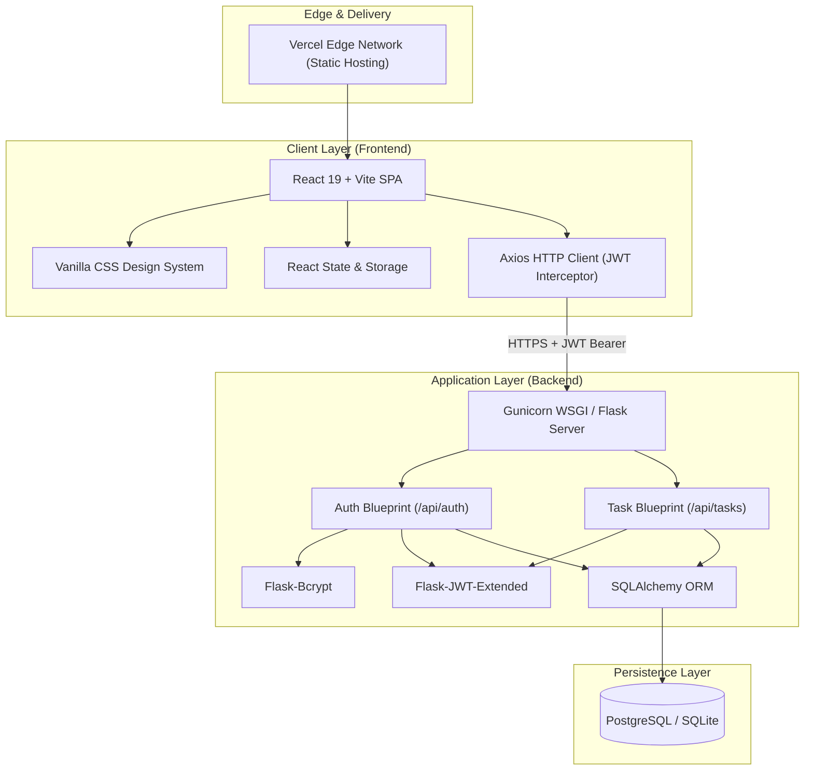
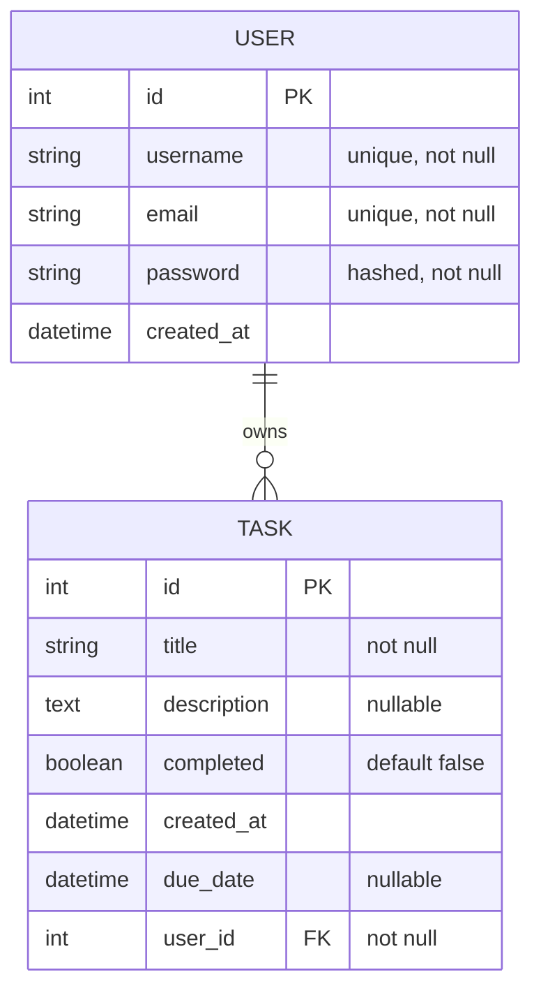
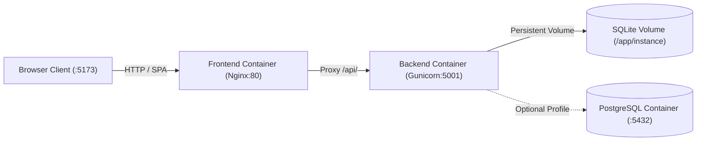

# System Architecture — Task Manager Pro

This document details the architectural design, component hierarchy, data models, and deployment topology of **Task Manager Pro**.

---

## 1. High-Level Architecture

Task Manager Pro is designed as a decoupled, client-server web application optimized for high performance, responsiveness, and minimal footprint.



---

## 2. Frontend Architecture

### 2.1 Technology Stack
- **Framework:** React 19 (`react`, `react-dom`)
- **Build Tool:** Vite 7 (Hot Module Replacement, fast ESBuild bundling)
- **Routing:** React Router DOM v7
- **HTTP Client:** Axios with request interceptor for JWT authorization
- **Styling:** Vanilla CSS (lightweight, zero bundle overhead, custom variables for themes)

### 2.2 Component Hierarchy

```
App.jsx (Root View Router & Auth State Guard)
├── Login.jsx (Authentication Entrypoint)
├── Register.jsx (User Sign-up)
└── Dashboard.jsx (Authenticated Workspace)
    ├── Header (Title, User Greeting, Logout)
    ├── Stats Overview (Total, Completed, Pending metrics)
    ├── TaskForm.jsx (Input form for title, description, due date)
    └── TaskList.jsx (Collection container)
        └── TaskItem.jsx (Task card with toggle, edit, delete actions)
```

### 2.3 State Management & Auth Flow
1. **Token Persistence:** Upon login or registration, the backend returns a signed JWT access token (`access_token`) and user object (`user`).
2. **Local Storage:** Tokens and user metadata are saved in `localStorage`.
3. **Request Interceptor:** Axios automatically injects `Authorization: Bearer <token>` into the headers for all outgoing requests.
4. **Optimistic Updates:** Task creation, toggling, and deletion update local React state immediately for instantaneous user feedback.

---

## 3. Backend Architecture

### 3.1 Technology Stack
- **Framework:** Flask 2.3+ (Application Factory Pattern via `create_app`)
- **ORM:** Flask-SQLAlchemy 3.0+
- **Security:** Flask-Bcrypt (password hashing), Flask-JWT-Extended (token creation and verification)
- **CORS:** Flask-CORS (Cross-Origin Resource Sharing)
- **WSGI Runner:** Gunicorn 21+

### 3.2 Blueprint Structure
- **Application Factory (`backend/app.py`):** Configures database connection, initializes JWT, binds CORS, registers blueprints, and creates database tables within the application context.
- **Authentication Blueprint (`backend/auth.py`):**
  - `POST /api/auth/register`: Unique email and username checks, password hashing, and user creation.
  - `POST /api/auth/login`: Credential validation and JWT issuance.
  - `GET /api/auth/protected`: Authenticated user session validation.
- **Tasks Blueprint (`backend/routes.py`):**
  - `GET /api/tasks`: Scoped retrieval of tasks belonging strictly to the authenticated `user_id`.
  - `POST /api/tasks`: Creation of user-scoped task with title, description, and optional due date.
  - `PUT /api/tasks/<id>`: Update task title, description, completed status, or due date.
  - `DELETE /api/tasks/<id>`: Scoped task deletion.

---

## 4. Database Schema & Data Models



### Security & Data Isolation
- Every task row contains a foreign key `user_id` referencing the `user.id`.
- Every task query in `routes.py` enforces `filter_by(user_id=current_user_id)` to prevent cross-tenant data leakage or horizontal privilege escalation.

---

## 5. Deployment Topology & Container Architecture

Task Manager Pro supports both serverless cloud hosting and fully containerized Docker deployments:

### 5.1 Docker Container Network


| Deployment Mode | Frontend | Backend | Persistence |
| :--- | :--- | :--- | :--- |
| **Docker Compose** | Nginx Alpine (Reverse Proxy + Static Assets) on `:5173` | Gunicorn (Python 3.11 Slim) on `:5001` | SQLite Docker Volume (`taskmanager-sqlite-data`) or PostgreSQL |
| **Cloud Hosting** | Vercel Edge SPA | Render Web Service | Render Managed PostgreSQL / SQLite |

---

## 6. Multi-Device Compatibility Strategy

To ensure fluid operation on both large screens (desktops, ultrawides) and small screens (smartphones, tablets):
1. **Fluid Typography & Spacing:** Clamp functions and relative units (`rem`, `ch`, `%`) rather than fixed pixel dimensions.
2. **Adaptive Grid / Flex Layouts:**
   - **Large Screens (≥1024px):** Multi-column workspace (Sidebar navigation, content list, detailed task editor or Kanban board).
   - **Medium Screens (768px – 1023px):** 2-column or collapsible drawer layout.
   - **Small Screens (<768px):** Single-column stacked layout, bottom navigation bar, floating action button (FAB), touch-friendly hit areas (≥44px).
