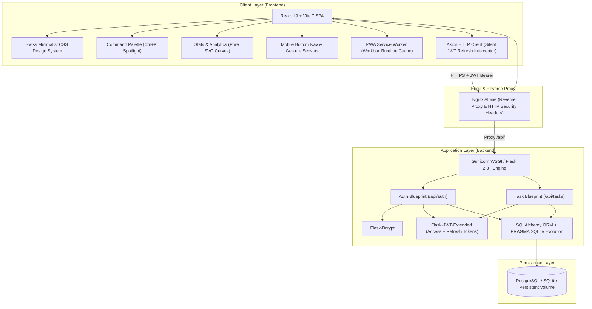
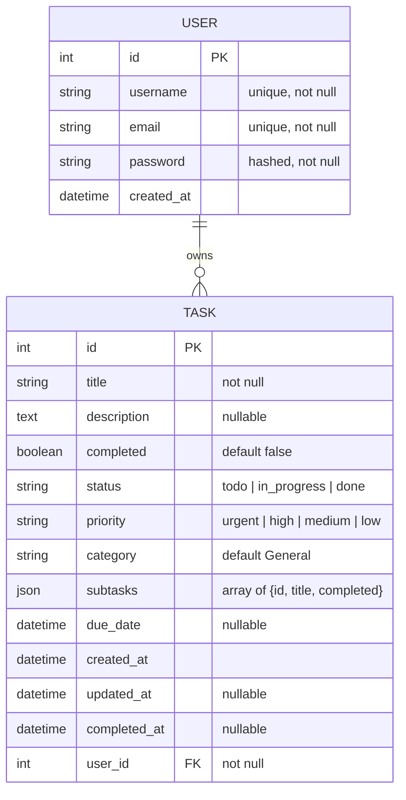
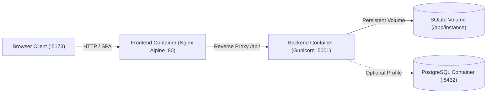

# System Architecture — Task Manager Pro

**Version:** 2.0.0  
**Last Updated:** November 2026

This document details the architectural design, component hierarchy, data models, and deployment topology of **Task Manager Pro**.

---

## 1. High-Level Architecture

Task Manager Pro is designed as a decoupled, client-server web application optimized for high performance, mobile ergonomics, and minimal bundle footprint.



---

## 2. Frontend Architecture

### 2.1 Technology Stack
- **Framework:** React 19 (`react`, `react-dom`)
- **Build Tool:** Vite 7 (ESBuild bundling, Hot Module Replacement)
- **Routing:** React Router DOM v7 (Declarative routing: `/login`, `/register`, `/app/:section`, `/app/project/:tag`, `/app/stats`)
- **HTTP Client:** Axios with bidirectional JWT request and 401 refresh token interceptor queue
- **Drag & Drop:** `@dnd-kit/core` (Pointer/touch sensors, column collision detection)
- **Styling:** Pure Vanilla CSS (CSS Custom Properties, zero third-party UI framework bloat)
- **PWA:** `vite-plugin-pwa` with service worker precaching and runtime caching

### 2.2 Component Hierarchy

```
App.jsx (Root View Router, PWA Update Toast & Auth State Guard)
├── Login.jsx (Authentication Entrypoint)
├── Register.jsx (User Sign-up)
└── Dashboard.jsx (Authenticated Workspace Cockpit)
    ├── Topbar (Brand, Search Bar, Global Hotkey Trigger, Theme Toggle, Profile Popover)
    ├── Sidebar Navigation (Desktop Views, Custom Project Tags, Workspace Utilities)
    ├── Inline Quick-Add (Desktop) & NewTaskModal.jsx (Mobile Drag-to-Dismiss Bottom Sheet)
    ├── TaskList.jsx (Dual-View Container: Linear List & 3-Column Kanban Board)
    │   ├── TaskItem.jsx (List Task Row with Axis-Locked Touch Swipe: Done / Delete)
    │   └── BoardTaskCard (Kanban Card with inline editor & subtask checklist toggle)
    ├── DailyCompanion.jsx (Rhythm Ring, 7-Day Week Strip, Scratchpad, Project Slices)
    ├── StatsDashboard.jsx (14-Day Pure SVG Velocity Curve, Streaks, Category Distribution)
    ├── CommandPalette.jsx (Global Spotlight Ctrl+K / Cmd+K with Cyclic Keyboard Nav)
    └── MobileBottomNav.jsx (Fixed Bottom Tab Bar <= 768px: Tasks, Board, Stats, Rhythm)
```

### 2.3 State Management & Auth Flow
1. **Token Persistence:** Upon login/registration, backend issues an `access_token` (15m expiration) and `refresh_token` (30d expiration).
2. **Axios Refresh Queue:** An Axios response interceptor intercepts 401 errors, halts outbound requests, acquires a fresh `access_token` via `/api/auth/refresh`, and replays queued requests transparently.
3. **Optimistic Updates:** Task creation, completion toggles, subtask changes, and deletions update local React state immediately for zero-latency user feedback.

---

## 3. Backend Architecture

### 3.1 Technology Stack
- **Framework:** Flask 2.3+ (Application Factory Pattern via `create_app()`)
- **ORM:** Flask-SQLAlchemy 3.0+
- **Security:** Flask-Bcrypt (password hashing), Flask-JWT-Extended (access and refresh token pairs)
- **CORS:** Flask-CORS
- **WSGI Server:** Gunicorn 21+

### 3.2 Blueprint Structure & Endpoints
- **Application Factory (`backend/app.py`):**
  - Database table creation and direct SQLite schema migration via `PRAGMA table_info(task)`.
  - Dynamic status dashboard and operational JSON endpoint at `GET /`.
- **Authentication Blueprint (`backend/auth.py`):**
  - `POST /api/auth/register`: Unique email/username validation, password hashing, and token generation.
  - `POST /api/auth/login`: Credential validation and JWT issuance.
  - `POST /api/auth/refresh`: Token rotation returning a fresh access token.
  - `GET /api/auth/protected`: Authenticated user session validation.
- **Tasks Blueprint (`backend/routes.py`):**
  - `GET /api/tasks`: Multi-criteria querying (by `status`, `priority`, `category`, `completed`, `search`, and `sort_by`), strictly scoped to `user_id`.
  - `POST /api/tasks`: Task creation with subtask validation and `completed_at` timestamp setting.
  - `PUT /api/tasks/<id>`: Partial task mutation with status and `completed_at` reconciliation.
  - `DELETE /api/tasks/<id>`: Scoped task deletion.
  - `POST/PUT/DELETE /api/tasks/<id>/subtasks`: Nested checklist operations.

---

## 4. Database Schema & Data Models



### Security & Multi-Tenant Isolation
- Every task row enforces a foreign key `user_id` referencing `user.id`.
- All queries in `routes.py` strictly enforce `filter_by(user_id=current_user_id)`. Cross-tenant data leakage is structurally impossible.

---

## 5. Deployment Topology & Container Architecture



| Deployment Mode | Frontend Container | Backend Container | Database |
| :--- | :--- | :--- | :--- |
| **Docker Compose** | Nginx Alpine (Reverse Proxy, Security Headers) on `:5173` | Gunicorn (Python 3.11 Slim) on `:5001` | SQLite Persistent Volume (`taskmanager-sqlite-data`) or PostgreSQL |
| **Cloud Hosting** | Vercel Edge SPA | Render Web Service | Render Managed PostgreSQL / SQLite |
